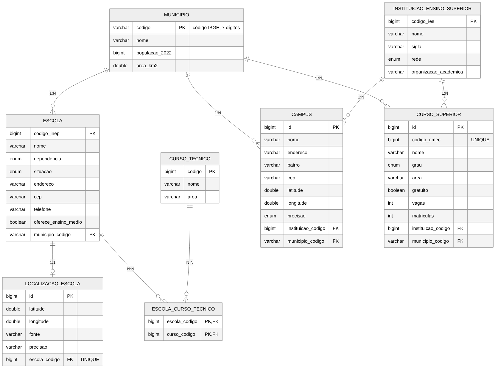
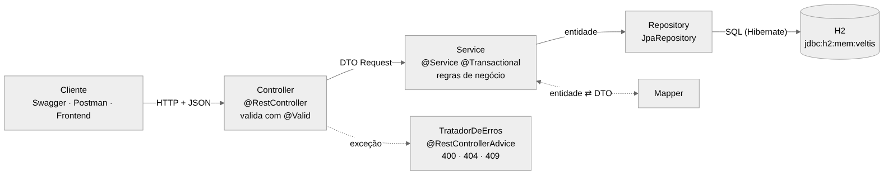

# Veltis — Backend Java/Spring Boot

Backend em **Java 17 + Spring Boot 4** do Projeto Integrador **Veltis** (ADS, Fatec Sorocaba). Foi feito para a disciplina **Técnicas Avançadas de Programação** (prof. Glauco Todesco).

O Veltis é um portal que mostra **num mapa as escolas, faculdades e cursos dos 27 municípios da Região Metropolitana de Sorocaba (RMS)**, a partir de dados públicos oficiais do IBGE e do INEP. Este backend implementa esse domínio com Spring Data JPA, CRUD, DTOs, Mappers, Bean Validation, banco H2 e **relacionamentos JPA reais** entre as entidades do projeto.

| | |
| --- | --- |
| **Participantes** | Julia Ribeiro Martins (backend e dados) · Daniel Lansana de Almeida (frontend) |
| **Orientador do PI** | prof. Cesar Munari |
| **Repositório do PI** | <https://github.com/martinsjul/veltis>. Este projeto fica na pasta `backend-java/`; o backend Python (pipelines de dados e API de leitura sobre o Supabase/PostGIS) está em `backend/`. |
| **Versão avaliada** | branch [`backend-java`](https://github.com/martinsjul/veltis/tree/backend-java/backend-java) do repositório do PI, pasta `backend-java/` (versão 1.0.0) |

---

## 1. Como rodar

**Precisa ter:** Java 17 ou mais novo (`java -version`). Não precisa instalar Maven, porque o projeto traz o *Maven Wrapper* (`mvnw`).

```bash
# Windows (Prompt de Comando ou PowerShell), dentro da pasta backend-java
mvnw.cmd spring-boot:run

# Linux / Mac
./mvnw spring-boot:run
```

Na primeira vez o Maven baixa as bibliotecas, o que leva alguns minutos. A aplicação está pronta quando aparece no console:

```
Seeding concluído: 27 municípios, 1806 escolas, 68 cursos técnicos, 33 instituições.
```

| Endereço | Para quê |
| --- | --- |
| <http://localhost:8080/swagger-ui.html> | **Swagger**: documentação e teste de todos os endpoints |
| <http://localhost:8080/h2-console> | **Console do H2**: ver as tabelas e as chaves estrangeiras |
| <http://localhost:8080/mapa/instituicoes> | Lista usada pelo mapa do frontend |

Para rodar os testes automáticos: `mvnw.cmd test` (Windows) ou `./mvnw test`.

No VS Code, também dá para abrir a classe `VeltisApplication.java` e clicar em **Run**. As extensões recomendadas são *Extension Pack for Java* e *Spring Boot Extension Pack*.

## 2. Banco de dados (H2)

O banco é o **H2 em memória**: ele é criado quando a aplicação inicia e apagado quando ela para. As tabelas são geradas pelo Hibernate a partir das entidades (`spring.jpa.hibernate.ddl-auto=create-drop`).

Para entrar no console do H2 (<http://localhost:8080/h2-console>):

| Campo | Valor |
| --- | --- |
| JDBC URL | `jdbc:h2:mem:veltis` |
| User Name | `sa` |
| Password | *(vazio)* |

Consultas úteis para a apresentação:

```sql
-- As chaves estrangeiras criadas pelo Hibernate
SELECT TABLE_NAME, CONSTRAINT_NAME FROM INFORMATION_SCHEMA.TABLE_CONSTRAINTS
WHERE CONSTRAINT_TYPE = 'FOREIGN KEY' ORDER BY TABLE_NAME;

-- Tabela de junção do N:N: cursos técnicos da ETEC Fernando Prestes
SELECT e.nome AS escola, c.nome AS curso
FROM escola_curso_tecnico ec
JOIN escola e ON e.codigo_inep = ec.escola_codigo
JOIN curso_tecnico c ON c.codigo = ec.curso_codigo
WHERE ec.escola_codigo = 35016238;

-- Quantas escolas cada município tem (1:N)
SELECT m.nome, COUNT(e.codigo_inep) AS escolas
FROM municipio m LEFT JOIN escola e ON e.municipio_codigo = m.codigo
GROUP BY m.nome ORDER BY escolas DESC;
```

### Dados iniciais (seeding)

A classe `seed/DadosIniciais` (um `CommandLineRunner`) carrega ao iniciar **dados reais da RMS**. Os CSVs estão em `src/main/resources/seed/` e foram exportados do banco do Veltis:

| Arquivo | Conteúdo | Fonte |
| --- | --- | --- |
| `municipios.csv` | 27 municípios, população e área | IBGE (Censo 2022 e malha municipal) |
| `escolas.csv` | 1.806 escolas | INEP, Censo Escolar 2025 |
| `localizacoes_escolas.csv` | 1.579 pontos oficiais | INEP Catálogo de Escolas / SEDUC-SP |
| `cursos_tecnicos.csv` | 68 cursos técnicos | INEP, Censo Escolar 2025 |
| `escola_curso_tecnico.csv` | 435 ofertas escola × curso | INEP, Censo Escolar 2025 |
| `instituicoes.csv` | 33 instituições com curso presencial | INEP, Censo da Educação Superior 2024 |
| `campi.csv` | 39 campi com latitude e longitude | Levantamento da equipe (endereço oficial + OpenStreetMap) |
| `cursos_superiores.csv` | 375 cursos presenciais | INEP, Censo da Educação Superior 2024 |

O seeding só roda com o banco vazio, então reiniciar não duplica nada. Para começar com o banco vazio, use `veltis.seed.ativo=false` no `application.properties`.

## 3. Entidades e relacionamentos JPA



*Fonte do diagrama: [`docs/diagrama-entidades.mmd`](docs/diagrama-entidades.mmd) (Mermaid).*

Todos os relacionamentos existem de verdade no domínio do Veltis. Nenhum foi criado só para cumprir a lista.

| Relacionamento | Regra de negócio | Anotações | Lado dono (tem a FK) | Chave estrangeira |
| --- | --- | --- | --- | --- |
| **Município 1 — N Escola** | Toda escola fica em um município; um município tem várias escolas. | `Escola`: `@ManyToOne` + `@JoinColumn`. `Municipio`: `@OneToMany(mappedBy = "municipio")` | `Escola` | `escola.municipio_codigo → municipio.codigo` |
| **Escola 1 — 1 Localização** | Cada escola tem no máximo um ponto no mapa (latitude, longitude, fonte e precisão). | `LocalizacaoEscola`: `@OneToOne` + `@JoinColumn(unique = true)`. `Escola`: `@OneToOne(mappedBy, cascade = ALL, orphanRemoval = true)` | `LocalizacaoEscola` | `localizacao_escola.escola_codigo → escola.codigo_inep` (**única**) |
| **Escola N — N Curso técnico** | Uma escola oferece vários cursos técnicos e um curso é oferecido por várias escolas. | `Escola`: `@ManyToMany` + `@JoinTable`. `CursoTecnico`: `@ManyToMany(mappedBy = "cursosTecnicos")` | `Escola` | Tabela de junção **`escola_curso_tecnico`** (`escola_codigo`, `curso_codigo`) |
| **Instituição 1 — N Campus** | Uma faculdade pode ter vários campi. | `Campus`: `@ManyToOne`. `InstituicaoEnsinoSuperior`: `@OneToMany(mappedBy, cascade = ALL, orphanRemoval = true)` | `Campus` | `campus.instituicao_codigo → instituicao_ensino_superior.codigo_ies` |
| **Município 1 — N Campus** | Cada campus fica em um município. | `Campus`: `@ManyToOne` | `Campus` | `campus.municipio_codigo → municipio.codigo` |
| **Instituição 1 — N Curso superior** | A faculdade oferece vários cursos. | `CursoSuperior`: `@ManyToOne`. `InstituicaoEnsinoSuperior`: `@OneToMany(mappedBy, cascade = ALL)` | `CursoSuperior` | `curso_superior.instituicao_codigo → ...codigo_ies` |
| **Município 1 — N Curso superior** | O município do curso é o **local de oferta**, não a sede da faculdade (regra RN-09 do PI). | `CursoSuperior`: `@ManyToOne` | `CursoSuperior` | `curso_superior.municipio_codigo → municipio.codigo` |

**Por que o lado dono é esse?** Em JPA, o lado dono é o que tem a chave estrangeira na sua tabela, e é ele que o Hibernate olha para gravar a associação. O outro lado usa `mappedBy` e serve só para navegar. No N:N, o dono (`Escola`) controla a tabela de junção: para associar um curso, o curso é adicionado em `escola.getCursosTecnicos()`.

**Sem ciclos no JSON:** as respostas da API nunca devolvem as entidades. Elas devolvem **DTOs** (`record`), e os relacionamentos aparecem como DTOs resumidos (ex.: `"municipio": {"codigo": "3552205", "nome": "Sorocaba"}`). Assim o JSON não entra em loop (escola → município → escolas → município…) e não expõe campos internos.

## 4. Arquitetura em camadas



```
controllers/   recebem a requisição HTTP e devolvem a resposta (status, JSON)
services/      regras de negócio e transações (@Transactional)
repositories/  acesso ao banco com JpaRepository (Spring Data JPA)
entities/      classes @Entity que viram tabelas
dtos/          objetos de entrada (Request, com Bean Validation) e de saída (Response)
mappers/       conversões entidade <-> DTO
exceptions/    exceções do domínio + TratadorDeErros (@RestControllerAdvice)
enums/         valores fixos (Dependencia, Rede, GrauAcademico...)
seed/          carga dos dados iniciais
config/        CORS, Swagger
```

Fluxo de uma requisição: **Controller → Service → Repository → banco**. Na volta, o Service converte a entidade em DTO com o Mapper e o Controller devolve o JSON.

## 5. Endpoints

| Recurso | Endpoints |
| --- | --- |
| Municípios | `GET /municipios` · `GET /municipios/{codigo}` · `POST /municipios` · `PUT /municipios/{codigo}` · `DELETE /municipios/{codigo}` · `GET /municipios/{codigo}/escolas` |
| Escolas | `GET /escolas?municipio=&dependencia=&nome=&page=&size=&sort=` · `GET /escolas/{codigoInep}` · `POST /escolas` · `PUT /escolas/{codigoInep}` · `DELETE /escolas/{codigoInep}` |
| Localização (1:1) | `PUT /escolas/{codigoInep}/localizacao` · `DELETE /escolas/{codigoInep}/localizacao` |
| Cursos da escola (N:N) | `GET /escolas/{codigoInep}/cursos-tecnicos` · `POST /escolas/{codigoInep}/cursos-tecnicos/{cursoCodigo}` · `DELETE /escolas/{codigoInep}/cursos-tecnicos/{cursoCodigo}` |
| Cursos técnicos | `GET /cursos-tecnicos` · `GET /cursos-tecnicos/{codigo}` · `POST` · `PUT /{codigo}` · `DELETE /{codigo}` · `GET /cursos-tecnicos/{codigo}/escolas` |
| Instituições | `GET /instituicoes` · `GET /instituicoes/{codigoIes}` · `POST` · `PUT /{codigoIes}` · `DELETE /{codigoIes}` · `GET /instituicoes/{codigoIes}/campi` · `GET /instituicoes/{codigoIes}/cursos` |
| Campi | `GET /campi?municipio=&instituicao=` · `GET /campi/{id}` · `POST /campi` · `PUT /campi/{id}` · `DELETE /campi/{id}` |
| Cursos superiores | `GET /cursos-superiores?municipio=&instituicao=` · `GET /cursos-superiores/{id}` · `POST` · `PUT /{id}` · `DELETE /{id}` |
| Mapa | `GET /mapa/instituicoes?municipio=&tipo=escola\|etec\|fatec\|faculdade` |

### Status HTTP usados

| Status | Quando |
| --- | --- |
| `200 OK` | Consulta ou alteração bem-sucedida |
| `201 Created` | Cadastro feito; o cabeçalho `Location` traz o endereço do novo registro |
| `204 No Content` | Exclusão feita |
| `400 Bad Request` | JSON inválido, campo que não passou na validação, parâmetro errado na URL |
| `404 Not Found` | Registro inexistente (inclusive o município ou a instituição citados num JSON) |
| `405 Method Not Allowed` | Método HTTP que o endereço não aceita |
| `409 Conflict` | Regra de negócio: código repetido, associação repetida, excluir município que ainda tem escolas |

Exemplo de erro de validação:

```json
{
  "status": 400,
  "erro": "Bad Request",
  "mensagem": "Dados inválidos. Corrija os campos indicados.",
  "caminho": "/municipios",
  "campos": [
    { "campo": "codigo", "mensagem": "O código IBGE deve ter 7 dígitos (ex.: 3552205)." },
    { "campo": "nome", "mensagem": "O nome é obrigatório." }
  ]
}
```

## 6. Exemplos de requisições

O arquivo [`requisicoes.http`](requisicoes.http) tem **todas as requisições da demonstração na ordem**. Ele pode ser aberto no VS Code com a extensão *REST Client*, ou as requisições podem ser copiadas para o Postman ou o Insomnia. Os principais exemplos:

**Ficha de uma escola com os três tipos de relacionamento**

```http
GET http://localhost:8080/escolas/35016238
```

```json
{
  "codigoInep": 35016238,
  "nome": "ETEC FERNANDO PRESTES",
  "tipo": "ETEC",
  "dependencia": "ESTADUAL",
  "situacao": "EM_ATIVIDADE",
  "municipio": { "codigo": "3552205", "nome": "Sorocaba" },
  "localizacao": { "latitude": -23.511556, "longitude": -47.471178, "fonte": "INEP - Catálogo de Escolas", "precisao": "oficial" },
  "cursosTecnicos": [ { "codigo": 6082, "nome": "Desenvolvimento de Sistemas", "area": "Informação e comunicação" }, "..." ]
}
```

**Cadastrar uma escola (associação N:1 pelo código do município)**

```http
POST http://localhost:8080/escolas
Content-Type: application/json

{
  "codigoInep": 99999999,
  "nome": "ETEC de Demonstração",
  "municipioCodigo": "3552205",
  "dependencia": "ESTADUAL",
  "situacao": "EM_ATIVIDADE",
  "cep": "18040810",
  "ofereceEnsinoMedio": true
}
```

**Associar um curso técnico à escola (N:N)**

```http
POST http://localhost:8080/escolas/99999999/cursos-tecnicos/6082
```

Essa requisição insere uma linha na tabela `escola_curso_tecnico`, que pode ser vista no console do H2. O `DELETE` no mesmo endereço remove a linha.

**Mapa: escolas e faculdades com latitude e longitude**

```http
GET http://localhost:8080/mapa/instituicoes?municipio=3552205&tipo=fatec
```

## 7. Regras de negócio implementadas

- **ETEC:** uma escola é ETEC quando é **estadual** e o nome começa com "ETEC " (`Escola.isEtec()`).
- **FATEC:** uma instituição é FATEC quando "FATEC" aparece na sigla ou no nome (`InstituicaoEnsinoSuperior.isFatec()`).
- **Códigos oficiais:** os códigos IBGE, INEP e e-MEC não podem se repetir (409). No `PUT`, o código do corpo precisa ser igual ao da URL (400).
- **Integridade:** um município com escolas, campi ou cursos não pode ser excluído (409).
- **Cascata:** excluir uma instituição exclui seus campi e cursos. Excluir uma escola exclui sua localização, mas não os cursos técnicos.
- **Coordenadas:** latitude e longitude precisam estar dentro do estado de São Paulo, o que pega latitude e longitude trocadas.
- **Associação N:N:** associar o mesmo curso duas vezes dá 409; remover uma associação que não existe dá 404.
- **Mapa:** só aparecem escolas com localização e, por padrão, em atividade. O curso superior aparece no campus do município onde é oferecido.

## 8. Testes automáticos

São 37 testes (JUnit 5 + MockMvc) que sobem a aplicação com o H2 e os dados reais e chamam os endpoints. Eles cobrem CRUD, validações, status HTTP, os três tipos de relacionamento, a cascata, o endpoint do mapa e as consultas SQL desta página (as 8 chaves estrangeiras criadas no H2). Cada teste desfaz o que gravou (`@Transactional`).

```bash
mvnw.cmd test        # Windows
./mvnw test          # Linux/Mac
```

## 9. Tecnologias

| Tecnologia | Versão | Uso |
| --- | --- | --- |
| Java | 17+ | Linguagem |
| Spring Boot | 4.1.2 | Aplicação, servidor web embutido (Tomcat) |
| Spring Data JPA / Hibernate | 4.1 / 7.4 | Entidades, repositórios e relacionamentos |
| Jakarta Bean Validation | 3 | Validação dos DTOs de entrada |
| H2 Database | 2.4 | Banco em memória com console web |
| springdoc-openapi | 3.1.1 | Swagger UI |
| JUnit 5 + MockMvc | — | Testes |
| Maven (Wrapper) | 3.9.11 | Build |
