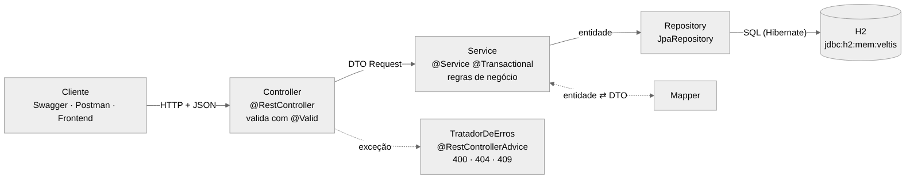

# Backend Java do Veltis — Guia completo para a apresentação

Este guia explica **tudo o que foi feito no backend Java** do Veltis, **como cada parte funciona** e **como apresentar**. Leia na ordem: cada seção usa o que a anterior explicou.

---

## 1. O que o professor pediu e onde está cada coisa

A atividade "Projeto Final — Seminário JPA e Projeto Integrador" pede que o backend do PI seja feito (ou melhorado) com Java e Spring Boot. A tabela mostra cada exigência e onde ela foi atendida.

| Exigência da atividade | Onde está no projeto |
| --- | --- |
| Java e orientação a objetos | Classes em `src/main/java/com/fatec/veltis/`, com atributos `private`, getters/setters e regras dentro das entidades (`isEtec()`, `isFatec()`) |
| Spring Boot configurado e executável | `VeltisApplication.java`, `pom.xml`, `application.properties`; roda com `mvnw.cmd spring-boot:run` |
| API REST com status adequados | Pasta `controllers/` (8 controllers); status 200, 201, 204, 400, 404, 405 e 409 |
| CRUD (criar, listar, buscar por id, atualizar, excluir) | Municípios, escolas, cursos técnicos, instituições, campi e cursos superiores: todos têm POST, GET, GET /{id}, PUT e DELETE |
| Spring Data JPA (entidades e `JpaRepository`) | Pasta `entities/` (7 entidades) e `repositories/` (7 interfaces que estendem `JpaRepository`) |
| Services com as regras de negócio | Pasta `services/` (7 services) |
| DTOs e Mappers | Pastas `dtos/` (20 records) e `mappers/` (7 classes) |
| Bean Validation | Anotações nos DTOs de entrada (`@NotBlank`, `@Pattern`, `@DecimalMin`...) + `@Valid` nos controllers + `TratadorDeErros` |
| Seeding | `seed/DadosIniciais.java`, que lê os CSVs em `src/main/resources/seed/` (dados reais da RMS) |
| H2 | `application.properties`; console em `/h2-console` |
| Relacionamentos JPA reais | `@ManyToOne`/`@OneToMany`, `@OneToOne` e `@ManyToMany` com `@JoinTable` (seção 6) |
| Diagrama e chaves estrangeiras | `docs/diagrama-entidades.png` e a seção 3 do README |
| README com objetivo, requisitos, execução, banco, participantes e exemplos | `README.md` |
| Demonstração em Postman/Insomnia/Swagger | Swagger em `/swagger-ui.html` + arquivo `requisicoes.http` com toda a demonstração |

---

## 2. A ideia geral em 1 minuto (para abrir a apresentação)

> "O Veltis mostra num mapa as escolas, faculdades e cursos dos 27 municípios da Região Metropolitana de Sorocaba, usando dados oficiais do IBGE e do INEP. Para esta disciplina, fizemos o backend em Java com Spring Boot. Os dados são reais: 1.806 escolas, 33 faculdades e 39 campi com latitude e longitude. O domínio tem os três tipos de relacionamento JPA, e todos vêm da regra de negócio: o **município tem várias escolas** (1:N), **cada escola tem um ponto no mapa** (1:1) e **escolas e cursos técnicos** se relacionam em muitos-para-muitos (N:N)."

---

## 3. Como rodar (passo a passo no Windows)

1. Confira se o Java está instalado: abra o Prompt de Comando e digite `java -version`. Precisa ser **17 ou mais novo**.
2. No repositório do Veltis, troque para a branch `backend-java` (`git checkout backend-java`) e abra a pasta `backend-java` no Explorador. Na barra de endereço, digite `cmd` e aperte Enter.
3. Digite `mvnw.cmd spring-boot:run` e aperte Enter.
4. Espere aparecer `Seeding concluído: 27 municípios, 1806 escolas, 68 cursos técnicos, 33 instituições.`. Na primeira vez, o Maven baixa as bibliotecas e demora alguns minutos.
5. Abra no navegador:
   - Swagger: <http://localhost:8080/swagger-ui.html>
   - Console do H2: <http://localhost:8080/h2-console> (JDBC URL `jdbc:h2:mem:veltis`, usuário `sa`, senha vazia)
6. Para parar, aperte **Ctrl + C** no Prompt.

**Pelo VS Code:** abra a pasta `backend-java`, abra `VeltisApplication.java` e clique em **Run** acima do `main`.

**Testes:** `mvnw.cmd test`. Devem aparecer **37 testes, 0 falhas**.

> **Atenção:** o banco é em memória. Ao parar a aplicação, tudo o que foi cadastrado some, e ao iniciar de novo os dados reais são recarregados. Isso é bom para a apresentação, porque sempre começa igual.

---

## 4. Arquitetura em camadas



*Fonte: [`arquitetura.mmd`](arquitetura.mmd) (Mermaid).*

| Camada | Pasta | O que faz | O que **não** faz |
| --- | --- | --- | --- |
| Controller | `controllers/` | Recebe a requisição, valida o JSON (`@Valid`), chama o service e devolve o status HTTP | Não tem regra de negócio e não acessa o banco |
| Service | `services/` | Regras de negócio, associações entre entidades, transações (`@Transactional`) | Não conhece HTTP |
| Repository | `repositories/` | Conversa com o banco (`save`, `findById`, `delete`, consultas) | Não tem regra |
| Entity | `entities/` | Representa as tabelas e os relacionamentos | Não vai para o JSON |
| DTO | `dtos/` | Formato do JSON de entrada (Request) e de saída (Response) | Não é salvo no banco |
| Mapper | `mappers/` | Copia dados entre entidade e DTO | Não decide nada |
| Exceptions | `exceptions/` | Transformam erros em respostas JSON com o status certo | — |

### Uma requisição do começo ao fim: `POST /escolas`

1. **O cliente** (Swagger/Postman) manda o JSON:
   ```json
   { "codigoInep": 99999999, "nome": "ETEC de Demonstração", "municipioCodigo": "3552205",
     "dependencia": "ESTADUAL", "situacao": "EM_ATIVIDADE", "ofereceEnsinoMedio": true }
   ```
2. **O Spring** transforma o JSON num `EscolaRequest` (record). Como o parâmetro tem `@Valid`, o Bean Validation confere as anotações. Se algo estiver errado (ex.: `municipioCodigo` com 3 dígitos), lança `MethodArgumentNotValidException`, o `TratadorDeErros` devolve **400** com a lista de campos, e o service nem é chamado.
3. **`EscolaController.criar`** chama `service.criar(dto)`.
4. **`EscolaService.criar`** (com `@Transactional`):
   - verifica se o código INEP já existe (`existsById`) e, se sim, lança `RegraDeNegocioException`, que vira **409**;
   - `EscolaMapper.toEntity(dto)` cria a entidade `Escola`;
   - busca o município com `municipioService.obter("3552205")` e, se ele não existir, devolve **404**;
   - `escola.setMunicipio(municipio)` faz a **associação N:1**, que preenche a FK `municipio_codigo`;
   - `escolaRepository.save(escola)` faz o Hibernate gerar o `INSERT INTO escola (...)`.
5. **`EscolaMapper.toDetalhe`** converte a entidade salva em `EscolaDetalheResponse`.
6. **O controller** devolve `ResponseEntity.created(...)`, ou seja, **201 Created**, com o cabeçalho `Location: /escolas/99999999` e o JSON da escola.

---

## 5. Cada pacote e cada classe

### `VeltisApplication.java`
Classe com o `main`. `@SpringBootApplication` liga a configuração automática do Spring Boot e procura componentes no pacote `com.fatec.veltis`. `@EnableSpringDataWebSupport(... VIA_DTO)` deixa o JSON das páginas (`Page`) num formato estável: `{ "content": [...], "page": {...} }`.

### `entities/` — as tabelas

| Classe | Tabela | Chave primária | Observação |
| --- | --- | --- | --- |
| `Municipio` | `municipio` | `codigo` (código IBGE, `String` de 7 dígitos) | Chave natural: vem da fonte oficial |
| `Escola` | `escola` | `codigoInep` (`Long`) | Chave natural do INEP; sem `@GeneratedValue` |
| `LocalizacaoEscola` | `localizacao_escola` | `id` gerado (`IDENTITY`) | Dona do 1:1 |
| `CursoTecnico` | `curso_tecnico` | `codigo` do INEP | Lado inverso do N:N |
| `InstituicaoEnsinoSuperior` | `instituicao_ensino_superior` | `codigoIes` | Lado inverso do 1:N com campus e curso |
| `Campus` | `campus` | `id` gerado | Tem latitude e longitude |
| `CursoSuperior` | `curso_superior` | `id` gerado; `codigoEmec` único | Município = local de oferta |

Anotações usadas nas entidades:
- `@Entity` marca a classe como tabela, e `@Table(name = "...")` define o nome da tabela.
- `@Id` é a chave primária. `@GeneratedValue(strategy = IDENTITY)` faz o banco gerar o número (1, 2, 3...).
- `@Column(nullable = false, length = 150)` cria a coluna com `NOT NULL` e `VARCHAR(150)`.
- `@Enumerated(EnumType.STRING)` grava o **nome** do enum (`ESTADUAL`) e não a posição (2). Assim, se alguém mudar a ordem do enum, os dados não se embaralham.
- `@UniqueConstraint` em `Campus` impede dois campi com o mesmo nome, da mesma instituição, no mesmo município.

Por que `equals` e `hashCode` em `Escola` e `CursoTecnico`? Porque elas ficam em `Set` no N:N, e o `Set` usa `equals`/`hashCode` para saber se um item já está lá. Duas instâncias com o mesmo código INEP representam a mesma escola.

### `enums/`
`Dependencia` (FEDERAL, ESTADUAL, MUNICIPAL, PRIVADA), `SituacaoFuncionamento`, `Rede`, `GrauAcademico` e `PrecisaoCampus`. Cada um tem um **rótulo** igual ao texto do arquivo oficial (ex.: "Estadual") e um método `doRotulo` usado no seeding. Com enum, um valor inválido no JSON (ex.: `"rede": "MISTA"`) é recusado com 400.

### `repositories/`
Interfaces que estendem `JpaRepository<Entidade, TipoDoId>`. Só por estender, já vêm prontos `save`, `findById`, `findAll`, `existsById`, `delete`, `count`... sem escrever SQL. Três recursos usados:
1. **Consulta pelo nome do método:** `findAllByOrderByNomeAsc()` vira `SELECT ... ORDER BY nome`, e `existsByMunicipioCodigo(codigo)` vira `SELECT ... WHERE municipio_codigo = ?`.
2. **`@Query` com JPQL** (consulta sobre as classes, não sobre as tabelas), com filtros opcionais: `(:municipio IS NULL OR e.municipio.codigo = :municipio)`. Se o filtro vier vazio, a condição é ignorada.
3. **`@EntityGraph(attributePaths = {"municipio", "localizacao"})`** busca as entidades relacionadas **na mesma consulta** (JOIN). Sem isso, listar 20 escolas faria 1 consulta para as escolas e mais 20 para os municípios: é o **problema N+1** (seção 9).

`Page<Escola> buscar(..., Pageable pageable)` faz a paginação: `?page=0&size=20&sort=nome`.

### `dtos/`
São `record`s do Java (classes imutáveis com construtor, getters, `equals` e `toString` automáticos).
- **Request** (entrada): `MunicipioRequest`, `EscolaRequest`, `LocalizacaoRequest`, `CursoTecnicoRequest`, `InstituicaoRequest`, `CampusRequest`, `CursoSuperiorRequest`. Eles têm as anotações de validação. As associações vêm **pelo código** (ex.: `municipioCodigo`), não pelo objeto inteiro.
- **Response** (saída): `...Response` e `...ResumoResponse`. Os relacionamentos aparecem como resumos (`MunicipioResumoResponse` só com código e nome).
- `InstituicaoNoMapaResponse` / `CursoNoMapaResponse` têm o mesmo formato da API Python, para o frontend do Daniel funcionar com os dois backends.
- `ErroResponse` é o formato padrão de erro.

**Por que não devolver a entidade direto?** Por três motivos:
1. **Ciclo infinito:** `Escola` tem `municipio`, e `Municipio` tem `escolas`, que têm `municipio`... O Jackson entraria em loop (`StackOverflowError`).
2. **Segurança e contrato:** o JSON mostra só o que deve mostrar, e mudar a tabela não quebra o frontend.
3. **Lazy loading:** a entidade pode ter relacionamentos ainda não carregados (`LAZY`), e serializar fora da transação daria `LazyInitializationException`.

### `mappers/`
Classes `final` com métodos `static`:
- `toEntity(request)` cria a entidade a partir do DTO de entrada;
- `copiar(request, entidade)` é usado no PUT, para alterar a entidade que já existe;
- `toResponse(entidade)` / `toResumo(entidade)` / `toDetalhe(entidade)` criam o DTO de saída.

Os mappers **não** buscam nada no banco. Associar o município é trabalho do service, que sabe buscar e validar.

### `services/`
Cada service recebe os repositories **pelo construtor** (injeção de dependência: o Spring cria e entrega os objetos). Pontos importantes:
- `@Transactional` deixa tudo dentro do método numa transação só: ou grava tudo, ou nada. Com `readOnly = true`, o Hibernate otimiza as leituras.
- **Dirty checking:** no `atualizar`, o service muda a entidade com `MunicipioMapper.copiar(...)` e **não chama `save`**. Como a entidade foi buscada dentro da transação, o Hibernate percebe a mudança e faz o `UPDATE` sozinho no fim do método.
- O método `obter(...)` busca pelo id ou lança `RecursoNaoEncontradoException` (404). Ele é reutilizado por outros services (ex.: `EscolaService` usa `municipioService.obter`).

### `controllers/`
- `@RestController` faz o retorno dos métodos virar JSON.
- `@RequestMapping("/escolas")` é o caminho base.
- `@GetMapping`, `@PostMapping`, `@PutMapping` e `@DeleteMapping` correspondem aos métodos HTTP.
- `@PathVariable` pega o valor da URL (`/escolas/{codigoInep}`), e `@RequestParam` pega o valor depois do `?` (`?municipio=3552205`).
- `@RequestBody` lê o JSON do corpo, e `@Valid` manda validar.
- `ResponseEntity.created(uri).body(...)` devolve 201 e `ResponseEntity.noContent()` devolve 204.
- `@Tag` e `@Operation` são os textos que aparecem no Swagger.

### `exceptions/`
- `RecursoNaoEncontradoException` vira 404, `RegraDeNegocioException` vira 409 e `RequisicaoInvalidaException` vira 400.
- `TratadorDeErros` (`@RestControllerAdvice`) pega as exceções de **todos** os controllers e monta o `ErroResponse`. Assim nenhum controller precisa de `try/catch`.

### `seed/`
- `LeitorCsv` lê os CSVs (separador `;`, aceita campos entre aspas).
- `DadosIniciais` é um `CommandLineRunner`, ou seja, roda logo depois que a aplicação sobe. Ele cria os objetos e **faz as associações pelos métodos das entidades** (`adicionarCursoTecnico`, `definirLocalizacao`, `adicionarCampus`). Também mostra o cascade funcionando: `instituicaoRepository.saveAll(...)` salva junto os campi e os cursos de cada instituição. Se o banco já tiver dados, ele não roda.

### `config/`
- `WebConfig` libera o **CORS** para o frontend (`localhost:5173`, o Vite) e aceita enums na URL sem diferenciar maiúsculas (`?tipo=etec` e `?tipo=ETEC`).
- `OpenApiConfig` define o título e a descrição do Swagger.

### `application.properties`
- `spring.datasource.url=jdbc:h2:mem:veltis` cria o banco H2 em memória.
- `spring.jpa.hibernate.ddl-auto=create-drop` faz o Hibernate criar as tabelas a partir das entidades ao iniciar e apagá-las ao parar.
- `spring.h2.console.enabled=true` liga o console web.
- `spring.jpa.open-in-view=false` faz as consultas terminarem dentro do service. Isso obriga a converter para DTO dentro da transação, que é a boa prática.
- `spring.jpa.show-sql=false`: troque para `true` para ver no console o SQL que o Hibernate gera (bom para a demonstração).

---

## 6. Os relacionamentos, um por um

### 6.1 Município 1 — N Escola (`@ManyToOne` / `@OneToMany`)

**Regra de negócio:** toda escola fica em **um** município, e um município tem **várias** escolas.

```java
// Escola.java — LADO DONO (tem a FK)
@ManyToOne(fetch = FetchType.LAZY, optional = false)
@JoinColumn(name = "municipio_codigo", nullable = false)
private Municipio municipio;

// Municipio.java — LADO INVERSO
@OneToMany(mappedBy = "municipio")
private List<Escola> escolas = new ArrayList<>();
```

**SQL gerado pelo Hibernate:**
```sql
create table escola ( ..., municipio_codigo varchar(7) not null, primary key (codigo_inep) );
alter table escola add constraint FK... foreign key (municipio_codigo) references municipio;
```

- **Dono:** `Escola`, porque a coluna `municipio_codigo` fica na tabela `escola`. No 1:N, a FK sempre fica do lado "N".
- **`mappedBy = "municipio"`:** diz ao Hibernate que esse lado não cria coluna nenhuma e só reflete o campo `municipio` da classe `Escola`. Sem `mappedBy`, o Hibernate criaria uma **tabela extra** `municipio_escolas`, o que é um erro comum.
- **`LAZY`:** o município só é buscado quando alguém chama `getMunicipio()`. É o mais eficiente.
- **Endpoints:** `POST /escolas` (associa pelo `municipioCodigo`), `GET /municipios/{codigo}/escolas` (navega do 1 para o N).
- **Integridade:** `DELETE /municipios/3552205` devolve **409**, porque Sorocaba tem escolas. O service confere antes (`existsByMunicipioCodigo`), e mesmo que não conferisse, a FK no banco impediria.

Os relacionamentos **Instituição 1 — N Campus**, **Município 1 — N Campus**, **Instituição 1 — N Curso superior** e **Município 1 — N Curso superior** seguem o mesmo padrão. A diferença é que em Instituição o `@OneToMany` tem `cascade = CascadeType.ALL, orphanRemoval = true`: **excluir a instituição exclui seus campi e cursos**. Por isso o `DELETE /instituicoes/33` funciona e leva tudo junto.

### 6.2 Escola 1 — 1 Localização (`@OneToOne`)

**Regra de negócio:** cada escola tem **no máximo um** ponto no mapa (latitude, longitude, de onde veio e qual a precisão), e cada ponto pertence a **uma** escola.

```java
// LocalizacaoEscola.java — LADO DONO
@OneToOne(fetch = FetchType.LAZY, optional = false)
@JoinColumn(name = "escola_codigo", nullable = false, unique = true)
private Escola escola;

// Escola.java — LADO INVERSO
@OneToOne(mappedBy = "escola", cascade = CascadeType.ALL, orphanRemoval = true, fetch = FetchType.LAZY)
private LocalizacaoEscola localizacao;
```

**SQL gerado:**
```sql
create table localizacao_escola ( ..., escola_codigo bigint not null unique, primary key (id) );
alter table localizacao_escola add constraint FK... foreign key (escola_codigo) references escola;
```

- **Por que a FK fica na localização?** Porque a localização **depende** da escola: não existe ponto sem escola, mas existe escola sem ponto (227 escolas não têm coordenada oficial). Com a FK na tabela filha, a escola não precisa de coluna vazia.
- **`unique = true`** é o que garante o "1" no banco: sem ele, seria um N:1.
- **`cascade = ALL`:** salvar a escola salva a localização junto. **`orphanRemoval = true`:** se a escola "solta" a localização (`definirLocalizacao(null)`), o Hibernate apaga a linha órfã.
- **Método auxiliar** `Escola.definirLocalizacao(...)`: liga os **dois lados** (`localizacao.setEscola(this)` e `this.localizacao = ...`). Em JPA, quem manda é o lado dono. Se só o lado inverso fosse preenchido, a FK ficaria vazia.
- **Endpoints:** `PUT /escolas/{id}/localizacao` (cria ou troca o ponto), `DELETE /escolas/{id}/localizacao`, `GET /escolas/{id}` (aparece em `"localizacao"`).
- **Validação:** latitude entre -25,4 e -19,7 e longitude entre -53,2 e -44,1 (estado de SP). Um JSON com latitude e longitude trocadas devolve **400**.

### 6.3 Escola N — N Curso técnico (`@ManyToMany` + `@JoinTable`)

**Regra de negócio:** uma escola oferece **vários** cursos técnicos (a ETEC Fernando Prestes tem 16), e o mesmo curso (ex.: Desenvolvimento de Sistemas) é oferecido por **várias** escolas.

```java
// Escola.java — LADO DONO
@ManyToMany
@JoinTable(
        name = "escola_curso_tecnico",
        joinColumns = @JoinColumn(name = "escola_codigo"),
        inverseJoinColumns = @JoinColumn(name = "curso_codigo"))
private Set<CursoTecnico> cursosTecnicos = new HashSet<>();

// CursoTecnico.java — LADO INVERSO
@ManyToMany(mappedBy = "cursosTecnicos")
private Set<Escola> escolas = new HashSet<>();
```

**SQL gerado:**
```sql
create table escola_curso_tecnico (
    curso_codigo bigint not null, escola_codigo bigint not null,
    primary key (curso_codigo, escola_codigo) );
alter table escola_curso_tecnico add constraint FK... foreign key (curso_codigo) references curso_tecnico;
alter table escola_curso_tecnico add constraint FK... foreign key (escola_codigo) references escola;
```

- **Tabela de junção:** `escola_curso_tecnico`, com uma linha para cada par escola × curso. A chave primária é composta pelas duas colunas, o que impede o mesmo par duas vezes.
- **`joinColumns`** é a coluna que aponta para o dono (escola), e **`inverseJoinColumns`** é a que aponta para o outro lado (curso).
- **`Set` em vez de `List`:** não deixa repetir, e o Hibernate apaga e insere só a linha certa na junção.
- **Métodos auxiliares** `adicionarCursoTecnico` / `removerCursoTecnico` atualizam **os dois lados** em memória.
- **Endpoints:**
  - `POST /escolas/99999999/cursos-tecnicos/6082` faz um `INSERT INTO escola_curso_tecnico` e devolve **201**; repetir dá **409**;
  - `GET /escolas/{id}/cursos-tecnicos` navega do dono para os cursos;
  - `GET /cursos-tecnicos/6082/escolas` navega pelo lado inverso;
  - `DELETE /escolas/{id}/cursos-tecnicos/{curso}` faz um `DELETE FROM escola_curso_tecnico` e devolve **204**.
- **Excluir um curso** (`DELETE /cursos-tecnicos/6082`): como o curso está do lado inverso, o service primeiro tira o curso de todas as escolas e só depois apaga. Sem isso, a FK da junção impediria a exclusão (seção 9).

### Resumo das 8 chaves estrangeiras

| Tabela | Coluna | Aponta para |
| --- | --- | --- |
| `escola` | `municipio_codigo` | `municipio.codigo` |
| `localizacao_escola` | `escola_codigo` (única) | `escola.codigo_inep` |
| `escola_curso_tecnico` | `escola_codigo` | `escola.codigo_inep` |
| `escola_curso_tecnico` | `curso_codigo` | `curso_tecnico.codigo` |
| `campus` | `instituicao_codigo` | `instituicao_ensino_superior.codigo_ies` |
| `campus` | `municipio_codigo` | `municipio.codigo` |
| `curso_superior` | `instituicao_codigo` | `instituicao_ensino_superior.codigo_ies` |
| `curso_superior` | `municipio_codigo` | `municipio.codigo` |

---

## 7. Bean Validation (validação de entrada)

As regras ficam **no DTO de entrada**, e o `@Valid` no controller faz o Spring conferir antes de chamar o service.

| Anotação | Exemplo no projeto | Erro quando |
| --- | --- | --- |
| `@NotBlank` | `nome` | vazio ou só espaços |
| `@NotNull` | `codigoInep`, `dependencia` | ausente |
| `@Pattern(regexp = "\\d{7}")` | código IBGE | não tem 7 dígitos |
| `@Pattern(regexp = "\\d{8}")` | CEP | não tem 8 dígitos |
| `@Size(max = 150)` | nomes | texto longo demais |
| `@Positive` / `@PositiveOrZero` | códigos, vagas | negativo |
| `@DecimalMin` / `@DecimalMax` | latitude/longitude | fora do estado de SP |

Também há validação nos parâmetros da URL: `GET /escolas?municipio=abc` devolve **400**, por causa do `@Pattern` direto no `@RequestParam`.

Resposta de erro (`POST /municipios` com `{"codigo": "123", "nome": ""}`):
```json
{
  "status": 400,
  "erro": "Bad Request",
  "mensagem": "Dados inválidos. Corrija os campos indicados.",
  "caminho": "/municipios",
  "campos": [
    { "campo": "nome", "mensagem": "O nome é obrigatório." },
    { "campo": "codigo", "mensagem": "O código IBGE deve ter 7 dígitos (ex.: 3552205)." }
  ]
}
```

**Validação × regra de negócio:** o Bean Validation confere o **formato** (7 dígitos). O service confere o que depende do banco (se o código já existe, se o município existe). Por isso uma é 400 e a outra é 409 ou 404.

---

## 8. Regras de negócio (todas nos services ou nas entidades)

| Regra | Onde | Resultado |
| --- | --- | --- |
| ETEC = escola **estadual** com nome começando por "ETEC " | `Escola.isEtec()` | campo `tipo` = "ETEC" |
| FATEC = "FATEC" na sigla ou no nome | `InstituicaoEnsinoSuperior.isFatec()` | `tipo` = "FATEC" |
| Código IBGE/INEP/e-MEC não pode repetir | services, `criar` | 409 |
| No PUT, o código do corpo = o código da URL | services, `atualizar` | 400 |
| Município com escolas, campi ou cursos não pode ser excluído | `MunicipioService.excluir` | 409 |
| Escola com município inexistente | `EscolaService.criar` | 404 |
| Mesmo curso duas vezes na escola | `EscolaService.adicionarCurso` | 409 |
| Excluir instituição leva campi e cursos | cascade na entidade | 204 |
| Excluir escola leva a localização, mas não os cursos | `orphanRemoval` + service | 204 |
| Mapa: só escolas com ponto e em atividade; curso no campus do município de oferta | `MapaService` | — |

---

## 9. Erros comuns de JPA (e como o projeto evita cada um)

O seminário pede para **explicar pelo menos um erro comum e sua correção**. Estes são os principais, todos relacionados ao código do projeto:

1. **Loop infinito no JSON** (`StackOverflowError` / "Infinite recursion"):
   - *Causa:* devolver a entidade `Escola`, que tem `municipio`, que tem `escolas`, que têm `municipio`...
   - *Correção no projeto:* devolver **DTOs**. O município aparece dentro da escola só como `{codigo, nome}`. Outra correção possível seria `@JsonIgnore`/`@JsonManagedReference`, mas o DTO é a preferida porque separa o banco do JSON.
2. **Esquecer o `mappedBy`:**
   - *Causa:* `@OneToMany List<Escola> escolas` sem `mappedBy`.
   - *Consequência:* o Hibernate cria uma tabela extra `municipio_escolas` e a relação fica duplicada.
   - *Correção:* `@OneToMany(mappedBy = "municipio")`.
3. **Preencher só o lado inverso:**
   - *Causa:* `curso.getEscolas().add(escola)` não grava nada, porque quem manda é o dono (`Escola`).
   - *Correção no projeto:* os métodos `adicionarCursoTecnico`/`definirLocalizacao` atualizam os dois lados.
4. **`LazyInitializationException`:**
   - *Causa:* acessar `escola.getMunicipio().getNome()` depois que a transação fechou.
   - *Correção no projeto:* a conversão para DTO acontece **dentro** do service `@Transactional`, com `open-in-view=false`.
5. **Problema N+1:**
   - *Causa:* listar 20 escolas e, para cada uma, o Hibernate buscar o município separadamente, fazendo 21 consultas.
   - *Correção no projeto:* `@EntityGraph(attributePaths = {"municipio", "localizacao"})` traz tudo numa consulta com JOIN.
6. **Apagar o lado inverso do N:N:**
   - *Causa:* `DELETE` direto em `curso_tecnico` enquanto ainda existem linhas em `escola_curso_tecnico`, o que viola a FK.
   - *Correção no projeto:* `CursoTecnicoService.excluir` tira o curso das escolas antes de apagar.
7. **`@Enumerated` sem `STRING`:**
   - *Causa:* o padrão grava a posição (0, 1, 2). Se a ordem do enum mudar, os dados ficam errados.
   - *Correção no projeto:* `@Enumerated(EnumType.STRING)`.

**Como demonstrar ao vivo (testado no projeto):** crie temporariamente um endpoint que devolve a **entidade** em vez do DTO:

```java
@GetMapping("/erro/escola/{id}")
public Escola escola(@PathVariable Long id) {
    return escolaRepository.findComDetalhesByCodigoInep(id).orElseThrow();
}
```

Chame `GET /erro/escola/35016238`. A API devolve **500**, e o console mostra:

```
Could not write JSON: Cannot lazily initialize collection of role
'com.fatec.veltis.entities.CursoTecnico.escolas' with key '6082' (no session)
```

**O que aconteceu:** o Jackson tentou transformar a escola em JSON e foi seguindo os relacionamentos: escola → cursosTecnicos → **escolas de cada curso** → cursos de cada escola... (o ciclo dos erros 1 e 4). Como a transação já tinha fechado, o Hibernate não conseguiu buscar a coleção `escolas` e deu `LazyInitializationException`. Se a coleção estivesse carregada, o resultado seria o loop infinito. **Correção:** devolver `EscolaDetalheResponse` (DTO), montado dentro do service. É o que o endpoint real `GET /escolas/{id}` faz. Depois da demonstração, apague o endpoint de teste.

---

## 10. Roteiro de demonstração (15 a 20 minutos)

Use o Swagger ou o arquivo `requisicoes.http` (VS Code + extensão *REST Client*). As requisições estão na ordem abaixo.

| Min. | Quem | O que mostrar |
| --- | --- | --- |
| 0–2 | Julia | O que é o Veltis, de onde vêm os dados e o diagrama de entidades (`docs/diagrama-entidades.png`) |
| 2–5 | Julia | Arquitetura em camadas e o código de uma entidade com relacionamento (`Escola.java`) |
| 5–8 | Daniel | **CRUD de município:** `GET /municipios`, `POST` com erro de validação (400), `POST` válido (201), `PUT`, `DELETE` (204), `DELETE /municipios/3552205` (409) |
| 8–11 | Julia | **N:1 e 1:1:** `POST /escolas` com `municipioCodigo`; `PUT /escolas/99999999/localizacao`; `GET /escolas/99999999` mostrando `municipio` e `localizacao`; latitude trocada → 400 |
| 11–14 | Daniel | **N:N:** `POST /escolas/99999999/cursos-tecnicos/6082`, repetir (409), `GET /cursos-tecnicos/6082/escolas`. No **console do H2**, `SELECT * FROM escola_curso_tecnico WHERE escola_codigo = 99999999` |
| 14–16 | Julia | **Console do H2:** as tabelas e a consulta das 8 FKs (README, seção 2); cascata com `DELETE /instituicoes/33` e `GET /campi?instituicao=33` vazio |
| 16–18 | Daniel | **Mapa:** `GET /mapa/instituicoes?municipio=3552205&tipo=fatec`, o JSON que o frontend usa, com latitude e longitude |
| 18–20 | Ambos | Um erro comum e a correção (seção 9) e os testes (`mvnw.cmd test` → 37 testes) |

> **Dica:** antes de apresentar, rode a aplicação e faça a sequência uma vez. Se algo der errado, pare e rode de novo: o banco volta ao estado inicial.

---

## 11. Perguntas que o professor pode fazer (com respostas)

**Qual é o lado dono do relacionamento entre Escola e Município? Por quê?**
A `Escola`. Ela tem o `@ManyToOne` com `@JoinColumn`, e a coluna `municipio_codigo` fica na tabela `escola`. Num 1:N, a FK fica sempre do lado N.

**Para que serve o `mappedBy`?**
Indica o lado inverso: diz que a relação já está mapeada pelo campo do outro lado. Sem ele, o Hibernate cria outra tabela ou outra coluna.

**Onde fica a FK do 1:1? Por que não na escola?**
Em `localizacao_escola.escola_codigo`, com `unique`. A localização depende da escola, e nem toda escola tem localização. Com a FK na filha, não sobra coluna vazia na escola.

**O que garante que é 1:1 e não N:1 no banco?**
O `unique = true` na coluna `escola_codigo`.

**Como funciona a tabela de junção?**
`escola_curso_tecnico` tem duas colunas, cada uma FK para uma tabela. A chave primária é o par. Associar insere uma linha e desassociar apaga a linha.

**Por que `Set` no N:N?**
Não permite duplicado, e o Hibernate consegue apagar só a linha certa da junção. Com `List`, ele pode apagar e reinserir todas as linhas.

**Diferença entre `LAZY` e `EAGER`?**
`LAZY` carrega o relacionamento só quando ele é usado; `EAGER` carrega sempre junto. O projeto usa `LAZY` e o `@EntityGraph` quando precisa trazer junto.

**O que é `cascade` e `orphanRemoval`?**
`cascade` repassa a operação para os filhos (salvar ou apagar a instituição salva ou apaga os campi). `orphanRemoval` apaga o filho que foi desligado do pai (tirar a localização da escola apaga a linha).

**Por que DTO e não a entidade no JSON?**
Evita loop infinito, não expõe a estrutura do banco, evita `LazyInitializationException` e deixa o contrato da API estável.

**Para que serve o Mapper? Por que não fazer a conversão no controller?**
Ele centraliza a conversão entidade ⇄ DTO num lugar só. O controller fica só com o HTTP, e o service só com as regras.

**Onde estão as regras de negócio?**
Nos services (validar duplicados, impedir exclusão com dependentes, associar entidades) e em métodos das entidades (`isEtec`, `isFatec`).

**Qual a diferença entre 400, 404 e 409 na sua API?**
400 = o pedido está mal formado (validação). 404 = o registro não existe. 409 = o pedido é válido, mas fere uma regra (duplicado, em uso).

**Por que o código da escola não é `@GeneratedValue`?**
Porque é o código oficial do INEP: ele vem da fonte e identifica a escola em todos os sistemas do governo.

**De onde vêm os dados do seeding?**
Do banco do Veltis, que é carregado com os arquivos oficiais do IBGE e do INEP pelo backend Python do PI. Os dados foram exportados para CSV, e o `DadosIniciais` lê esses CSVs ao iniciar.

**Por que H2?**
Banco em memória, sem instalação, com console web para ver as tabelas. É ideal para desenvolvimento e para a avaliação. Em produção, o Veltis usa PostgreSQL/PostGIS no Supabase, e bastaria trocar a URL no `application.properties`.

**O que acontece se eu reiniciar a aplicação?**
O H2 em memória é apagado, o Hibernate recria as tabelas e o seeding recarrega os dados reais.

**Como o Spring sabe qual repository injetar no service?**
Pela **injeção de dependência**: o service pede o repository no construtor, e o Spring, que criou uma implementação da interface, entrega a instância.

**O que o `@Transactional` faz?**
Abre uma transação no começo do método e faz commit no fim, ou rollback se der exceção. Dentro dela, o Hibernate acompanha as entidades e grava as alterações sozinho (dirty checking).

---

## 12. Relação com o resto do PI

O Veltis tem **dois backends** com papéis diferentes:

| | Backend Python (repositório do PI, `backend/`) | Backend Java (este projeto) |
| --- | --- | --- |
| Papel | Baixa, valida e carrega os dados oficiais no banco de produção (Supabase/PostGIS); API de leitura com GeoJSON | Implementa o domínio com Spring Boot/JPA: CRUD, relacionamentos e validação |
| Banco | PostgreSQL + PostGIS (Supabase) | H2 (avaliação); pode apontar para PostgreSQL |
| Mapa | `GET /mapa/instituicoes` (porta 8000) | `GET /mapa/instituicoes` (porta 8080), **mesmo JSON** |

O frontend do Daniel pode usar qualquer um dos dois: basta trocar o endereço.

---

## 13. Números para lembrar

- **27** municípios, **1.806** escolas, **68** cursos técnicos, **435** ofertas escola×curso;
- **33** instituições, **39** campi com latitude e longitude, **375** cursos presenciais;
- **7** entidades, **8** chaves estrangeiras, **1** tabela de junção;
- **8** controllers, **7** services, **7** repositories, **20** DTOs, **7** mappers;
- **37** testes automáticos.
