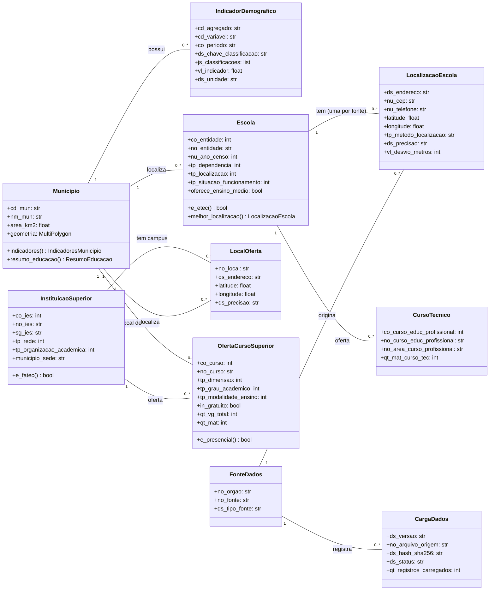

# Diagrama de classes — Veltis

Modelo de domínio: as classes representam os conceitos que o portal apresenta e como se relacionam. Os atributos usam os nomes das colunas do banco (ver `docs/dados/`). Os métodos são as consultas que a API oferece para cada conceito.

Este diagrama substitui o do documento Veltis_1_1, que trazia atributos inexistentes na base (IDH, faixas de 15 a 64 e 65+ anos, turno do curso) e uma única classe para escola e faculdade.

**Fonte:** Elaborado pelos autores.

Observações:

- `Escola` e `InstituicaoSuperior` são classes diferentes porque vêm de censos diferentes e têm dados diferentes. No mapa, a API une as duas numa lista (`/mapa/instituicoes`), com o campo `tipo` (Escola, ETEC, FATEC, Faculdade/Universidade).
- `IndicadorDemografico` guarda um valor por linha; a classificação (sexo, faixa de idade...) faz parte do valor (DEC-003). Indicadores disponíveis: população 2022 e estimativas, área e densidade, sexo e faixas de idade, alfabetização, frequência escolar e nível de instrução. **Não há IDH** na base.
- `LocalOferta` existe porque o Censo da Educação Superior não publica coordenadas (DEC-001).
