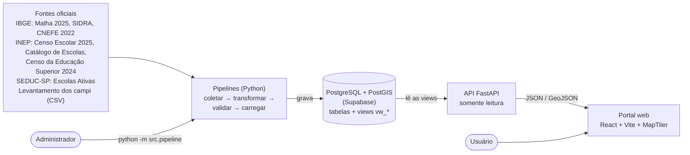

# Visão arquitetural — Veltis

- **Versão:** 1.1 — sugestão de revisão
- **Atualizado em:** 2026-11-10
- **Base de código conferida:** `main`, commit `352baab69b1de0e0350f7f81246a3f4162311409`.

## 1. Visão geral

O Veltis tem três partes que conversam em uma direção: os **pipelines** trazem os dados oficiais para o **banco**; a **API** lê o banco; o **site** lê a API. O site não acessa o banco diretamente, e a API não grava dados.

**Fonte:** Elaborado pelos autores; sugestão de atualização da localização do frontend após sua integração na branch principal.

## 2. Componentes

| Componente | Responsabilidade | Tecnologia | Onde |
| --- | --- | --- | --- |
| Pipelines | Baixar as fontes, transformar, validar e carregar; registrar cada carga | Python 3.11+, pandas, geopandas, SQLAlchemy, requests, geocodebr | `backend/src/` |
| Banco de dados | Guardar os dados com integridade (chaves, restrições), geometrias e histórico das cargas | PostgreSQL 17 + PostGIS 3.3 (Supabase) | `backend/database/migrations/` |
| Views | Entregar os dados prontos para leitura: códigos traduzidos, melhor localização, coordenadas em WGS 84 | SQL | migrations 003 a 005 |
| API | Expor as views em JSON e GeoJSON, com filtros, busca e paginação | FastAPI, Uvicorn | `backend/api/` |
| Portal web | Mapa, filtros e painéis de detalhe | React, Vite, MapTiler SDK | `frontend/` (integrado à `main` no commit `352baab`) |

### 2.1 Pipelines (ordem de execução)

| # | Etapa | Fonte | Tabela |
| --- | --- | --- | --- |
| 1 | `malha` | IBGE Malha Municipal 2025 | `ibge_municipios` |
| 2 | `sidra` | IBGE SIDRA (API v3): Censo 2022 e estimativas | `ibge_demografico` |
| 3 | `censo_escolar` | INEP Censo Escolar 2025 | `inep_escola`, `inep_curso_tecnico` |
| 4 | `localizacao` | INEP Catálogo de Escolas + SEDUC-SP | `escola_localizacao` |
| 5 | `geocodificacao` | IBGE CNEFE 2022 via geocodebr | `escola_localizacao` (só escolas sem ponto oficial) |
| 6 | `censo_superior` | INEP Censo da Educação Superior 2024 | `mec_ies`, `mec_cursos` |
| 7 | `locais_ies` | Levantamento dos campi (CSV) | `ies_local_oferta` |

Cada etapa calcula o hash do arquivo e pula uma fonte já carregada; caso contrário, valida recorte da RMS, colunas, domínios e duplicidade, e grava em uma transação. O resultado é registrado em `controle_ingestao` (`INICIADA` → `CONCLUIDA` ou `FALHA`). Ao final, `src/verificar.py` confere contagens e regras. A existência desses artefatos não comprova execução em ambiente implantado.

### 2.2 API

| Grupo | Endereços |
| --- | --- |
| Mapa | `/mapa/instituicoes` |
| Municípios | `/municipios`, `/municipios/indicadores`, `/municipios/{cd_mun}` |
| Escolas | `/escolas`, `/escolas/sem-localizacao`, `/escolas/{co_entidade}` |
| Cursos | `/cursos-tecnicos`, `/cursos-superiores`, `/instituicoes` |
| Geral | `/filtros`, `/fontes`, `/saude` |

Documentação interativa em `/docs` (OpenAPI). O guia de integração frontend está em `docs/uso interno/`.

## 3. Decisões de arquitetura

As decisões e seus motivos estão em `docs/decisoes/`: tabela demográfica única (DEC-003), fontes de localização (DEC-004), API somente leitura sobre views (DEC-005), município de oferta (DEC-006), coordenadas das faculdades (DEC-001), geocodificação das escolas (DEC-002) e Power BI/Data Warehouse como trabalho futuro (DEC-007).

## 4. Segurança e dados

- Credenciais devem ficar apenas em `backend/.env`, ignorado pelo Git.
- RLS está habilitado nas tabelas, sem políticas; a API automática do Supabase (chave anônima) não acessa esses dados. As views usam `security_invoker = true`.
- A API usa transação somente leitura, tempo limite de 10 s, parâmetros SQL e mensagens de erro sem detalhes técnicos.
- O download do INEP verifica o certificado TLS; a verificação não deve ser desligada.
- Os dados tratados são públicos e agregados por instituição ou município; não foi identificada coleta de dados pessoais no escopo descrito.

> **Status da proposta:** arquivo de revisão gerado a partir da documentação da equipe e do commit citado. Não substitui nem altera o original, e requer validação dos autores antes de adoção.
