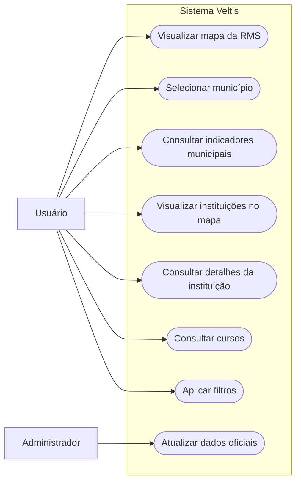

# Casos de uso — Veltis

- **Projeto:** Veltis 
- **Versão:** 1.2 (revisão de 2026-11-10: casos de uso de consulta agrupados, de 12 para 8, junto com a especificação de requisitos 0.4)
- **Plataforma:** Aplicação web
- **Atores:** Usuário (qualquer pessoa que acessa o portal) e Administrador (integrante da equipe que mantém a base de dados)

## 1. Diagrama de casos de uso geral

### Figura X – Diagrama de Casos de Uso do Veltis

**Fonte:** Elaborado pelos autores.

## 2. Descrição sucinta das funcionalidades

- **Visualizar mapa da RMS:** apresenta a malha geográfica dos municípios da Região Metropolitana de Sorocaba, as camadas do mapa e as fontes dos dados.
- **Selecionar município:** permite escolher um município para consultar as informações relacionadas a ele.
- **Consultar indicadores municipais:** apresenta os indicadores demográficos e o resumo da educação do município selecionado.
- **Visualizar instituições no mapa:** apresenta as escolas, ETECs, FATECs e faculdades como pontos no mapa e lista à parte as escolas sem localização.
- **Consultar detalhes da instituição:** permite selecionar uma escola ou faculdade e consultar suas informações.
- **Consultar cursos:** apresenta os cursos técnicos da escola ou os cursos superiores da faculdade no município.
- **Aplicar filtros:** permite restringir os resultados por município, tipo de instituição, rede e nome.
- **Atualizar dados oficiais:** o administrador executa os pipelines que baixam, validam e carregam os dados do IBGE, do INEP e da SEDUC-SP.

### Correspondência com a versão 1.1

| Versão 1.2 | Casos de uso da versão 1.1 agrupados |
| - | - |
| UC-01 | UC-01 Visualizar mapa da RMS, UC-11 Ativar ou desativar camadas |
| UC-02 | UC-02 Selecionar município |
| UC-03 | UC-03 Consultar indicadores municipais |
| UC-04 | UC-04 Visualizar escolas, UC-07 Visualizar instituições de ensino superior |
| UC-05 | UC-05 Consultar detalhes da escola, UC-08 Consultar detalhes da instituição |
| UC-06 | UC-06 Consultar cursos técnicos, UC-09 Consultar cursos superiores |
| UC-07 | UC-10 Aplicar filtros |
| UC-08 | UC-12 Atualizar dados oficiais |

---

# 3. Especificação dos casos de uso

## UC-01 — Visualizar mapa da RMS

- **Objetivo:** permitir que o usuário visualize a malha geográfica da Região Metropolitana de Sorocaba e controle as camadas do mapa.
- **Ator(es):** Usuário.
- **Requisito(s) relacionado(s):** RF-01, RF-07.
- **Interface/plataforma:** Aplicação web.
- **Versão e situação:** 1.2 — implementado; controle de camadas planejado.

### Condições
- **Gatilho:** o usuário acessa a aplicação.
- **Pré-condições:** não definidas.
- **Pós-condições:** a malha geográfica é apresentada no mapa.

### Fluxo principal

| Passo | Ator | Ação do ator | Resposta do sistema |
|---|---|---|---|
| 1 | Usuário | Acessa a aplicação. | O sistema carrega a interface e apresenta o mapa. |
| 2 | — | — | O sistema exibe a malha geográfica dos municípios da RMS e as instituições. |
| 3 | Usuário | Ativa ou desativa uma camada do mapa. | O sistema mostra ou oculta a camada escolhida. |

### Fluxos alternativos e exceções
- **A partir do passo 2:** se a API não responder, o sistema informa que não foi possível carregar os dados.

### Regras, dados e variações de plataforma
- **Regras relacionadas:** RN-05 e RN-08.
- **Dados relevantes:** malha municipal, identificadores dos municípios e data da última carga.
- **Variações web/mobile:** aplicação web.
- **Critério de aceite:** ao abrir a aplicação, a malha dos 27 municípios deve ser apresentada no mapa.

## UC-02 — Selecionar município

- **Objetivo:** permitir que o usuário escolha um município para consultar seus dados.
- **Ator(es):** Usuário.
- **Requisito(s) relacionado(s):** RF-01, RF-02.
- **Interface/plataforma:** Aplicação web.
- **Versão e situação:** 1.2 — implementado.

### Condições
- **Gatilho:** o usuário deseja consultar informações de um município.
- **Pré-condições:** a aplicação deve estar acessível e apresentar os municípios disponíveis.
- **Pós-condições:** o município escolhido passa a ser usado como referência para as consultas e a exibição dos dados.

### Fluxo principal

| Passo | Ator | Ação do ator | Resposta do sistema |
|---|---|---|---|
| 1 | Usuário | Abre a seleção de municípios. | O sistema apresenta os municípios disponíveis. |
| 2 | Usuário | Escolhe um município. | O sistema aplica a seleção. |
| 3 | — | — | O sistema atualiza o mapa e os resultados com as instituições do município. |

### Fluxos alternativos e exceções
- **A partir do passo 3:** se o usuário remover a seleção, o mapa volta a mostrar a RMS inteira (RN-05).

### Regras, dados e variações de plataforma
- **Regras relacionadas:** RN-01, RN-02 e RN-05.
- **Dados relevantes:** código IBGE e nome do município.
- **Variações web/mobile:** aplicação web.
- **Critério de aceite:** após selecionar um município, os resultados devem corresponder ao município escolhido.

## UC-03 — Consultar indicadores municipais

- **Objetivo:** permitir que o usuário consulte os indicadores disponíveis para um município.
- **Ator(es):** Usuário.
- **Requisito(s) relacionado(s):** RF-06.
- **Interface/plataforma:** Aplicação web.
- **Versão e situação:** 1.2 — API implementada; interface planejada.

### Condições
- **Gatilho:** o usuário solicita a consulta de indicadores.
- **Pré-condições:** um município deve estar selecionado.
- **Pós-condições:** os indicadores do município são apresentados.

### Fluxo principal

| Passo | Ator | Ação do ator | Resposta do sistema |
|---|---|---|---|
| 1 | Usuário | Seleciona um município. | O sistema identifica o município selecionado. |
| 2 | Usuário | Solicita a consulta dos indicadores. | O sistema consulta os indicadores do município. |
| 3 | — | — | O sistema apresenta os indicadores e o resumo da educação. |

### Fluxos alternativos e exceções
- Não há fluxos alternativos documentados nesta versão.

### Regras, dados e variações de plataforma
- **Regras relacionadas:** RN-06.
- **Dados relevantes:** código IBGE, indicador, unidade de medida, período e, quando aplicável, classificações (sexo, faixa de idade).
- **Variações web/mobile:** aplicação web.
- **Critério de aceite:** os indicadores apresentados devem corresponder ao município selecionado e aos dados do IBGE.

## UC-04 — Visualizar instituições no mapa

- **Objetivo:** permitir que o usuário veja no mapa as escolas, ETECs, FATECs e faculdades da RMS ou do município selecionado.
- **Ator(es):** Usuário.
- **Requisito(s) relacionado(s):** RF-02, RF-03, RF-04.
- **Interface/plataforma:** Aplicação web.
- **Versão e situação:** 1.2 — implementado; lista de escolas sem localização planejada na interface.

### Condições
- **Gatilho:** o usuário abre o mapa ou seleciona um município.
- **Pré-condições:** a aplicação deve ter dados de instituições disponíveis.
- **Pós-condições:** as instituições que atendem aos filtros aparecem como pontos no mapa.

### Fluxo principal

| Passo | Ator | Ação do ator | Resposta do sistema |
|---|---|---|---|
| 1 | Usuário | Abre o mapa ou seleciona um município. | O sistema consulta as instituições correspondentes. |
| 2 | — | — | O sistema apresenta como pontos as instituições que têm coordenada válida, com a cor de cada tipo. |

### Fluxos alternativos e exceções
- **A partir do passo 2:** escolas sem coordenada (nem oficial nem calculada pelo endereço) não aparecem como ponto e são apresentadas na lista "Escolas sem localização" (RN-04).

### Regras, dados e variações de plataforma
- **Regras relacionadas:** RN-01, RN-02, RN-03, RN-04, RN-07, RN-09 e RN-10.
- **Dados relevantes:** identificador, nome, tipo, município, rede, latitude, longitude e precisão da localização.
- **Variações web/mobile:** aplicação web.
- **Critério de aceite:** os pontos devem corresponder ao município e aos filtros selecionados e representar apenas registros com coordenadas válidas.

## UC-05 — Consultar detalhes da instituição

- **Objetivo:** permitir que o usuário consulte os dados de uma escola ou faculdade.
- **Ator(es):** Usuário.
- **Requisito(s) relacionado(s):** RF-05.
- **Interface/plataforma:** Aplicação web.
- **Versão e situação:** 1.2 — implementado.

### Condições
- **Gatilho:** o usuário seleciona uma instituição no mapa ou na lista.
- **Pré-condições:** a instituição deve estar disponível nos resultados da consulta.
- **Pós-condições:** os dados da instituição são apresentados num painel.

### Fluxo principal

| Passo | Ator | Ação do ator | Resposta do sistema |
|---|---|---|---|
| 1 | Usuário | Seleciona uma instituição. | O sistema identifica a instituição selecionada. |
| 2 | — | — | O sistema apresenta no painel o nome, o tipo, a rede, o endereço e o telefone disponíveis. |

### Fluxos alternativos e exceções
- Não há fluxos alternativos documentados nesta versão.

### Regras, dados e variações de plataforma
- **Regras relacionadas:** RN-10.
- **Dados relevantes:** código INEP da escola ou código da IES, nome, sigla, rede, endereço e telefone.
- **Variações web/mobile:** aplicação web.
- **Critério de aceite:** o painel deve apresentar os dados da instituição selecionada.

## UC-06 — Consultar cursos

- **Objetivo:** permitir que o usuário consulte os cursos técnicos de uma escola ou os cursos superiores de uma faculdade no município.
- **Ator(es):** Usuário.
- **Requisito(s) relacionado(s):** RF-05.
- **Interface/plataforma:** Aplicação web.
- **Versão e situação:** 1.2 — implementado; validar.

### Condições
- **Gatilho:** o usuário abre os cursos de uma instituição.
- **Pré-condições:** uma instituição deve estar selecionada.
- **Pós-condições:** os cursos da instituição no município são apresentados.

### Fluxo principal

| Passo | Ator | Ação do ator | Resposta do sistema |
|---|---|---|---|
| 1 | Usuário | Seleciona uma instituição. | O sistema identifica a instituição e o município. |
| 2 | Usuário | Abre os cursos. | O sistema consulta os cursos oferecidos naquele local. |
| 3 | — | — | O sistema apresenta os cursos com área, grau e vagas quando disponíveis. |

### Fluxos alternativos e exceções
- **A partir do passo 2:** cursos EAD aparecem em cada município onde há alunos matriculados; para mostrar só o que funciona na cidade, a consulta usa a modalidade presencial (RN-09).

### Regras, dados e variações de plataforma
- **Regras relacionadas:** RN-09.
- **Dados relevantes:** código e nome do curso, área profissional ou área CINE, grau acadêmico, modalidade, gratuidade, vagas e matrículas. O Censo da Educação Superior não informa o turno.
- **Variações web/mobile:** aplicação web.
- **Critério de aceite:** os cursos apresentados devem corresponder à instituição e ao município consultados.

## UC-07 — Aplicar filtros

- **Objetivo:** permitir que o usuário refine os resultados exibidos no sistema.
- **Ator(es):** Usuário.
- **Requisito(s) relacionado(s):** RF-02, RF-03.
- **Interface/plataforma:** Aplicação web.
- **Versão e situação:** 1.2 — implementado.

### Condições
- **Gatilho:** o usuário deseja restringir os resultados apresentados.
- **Pré-condições:** a aplicação deve ter dados disponíveis para consulta.
- **Pós-condições:** o mapa e a lista são atualizados conforme os filtros.

### Fluxo principal

| Passo | Ator | Ação do ator | Resposta do sistema |
|---|---|---|---|
| 1 | Usuário | Escolhe um ou mais filtros (município, tipo, rede) ou digita um nome. | O sistema registra os filtros. |
| 2 | — | — | O sistema atualiza o mapa e a lista com os resultados filtrados. |

### Fluxos alternativos e exceções
- **A partir do passo 2:** se nenhuma instituição atender aos filtros, o sistema informa que não há resultados.

### Regras, dados e variações de plataforma
- **Regras relacionadas:** RN-01 e RN-02.
- **Dados relevantes:** município, tipo de instituição, rede e termo de pesquisa.
- **Variações web/mobile:** aplicação web.
- **Critério de aceite:** os resultados devem respeitar os filtros selecionados.

## UC-08 — Atualizar dados oficiais

- **Objetivo:** manter a base do Veltis igual às fontes oficiais mais recentes.
- **Ator(es):** Administrador.
- **Requisito(s) relacionado(s):** RF-08, RNF-08, RNF-09.
- **Interface/plataforma:** linha de comando no computador da equipe (`backend/`).
- **Versão e situação:** 1.2 — implementado.

### Condições
- **Gatilho:** sai uma nova edição de uma fonte (Censo Escolar, Censo Superior, malha do IBGE, SIDRA) ou o administrador corrige um arquivo de referência.
- **Pré-condições:** acesso ao banco configurado no arquivo `.env`; arquivos manuais (Catálogo INEP, SEDUC-SP) colocados em `backend/data/raw` quando forem atualizados.
- **Pós-condições:** dados carregados, carga registrada em `CONTROLE_INGESTAO` e relatório de verificação sem erros.

### Fluxo principal

| Passo | Ator | Ação do ator | Resposta do sistema |
|---|---|---|---|
| 1 | Administrador | Ajusta o ano da edição em `src/config/edicoes.py`, se for o caso. | — |
| 2 | Administrador | Executa `python -m src.pipeline`. | O sistema baixa as fontes, valida e carrega cada etapa na ordem. |
| 3 | — | — | O sistema registra cada carga (arquivo, hash, contagens, status). |
| 4 | — | — | O sistema executa a verificação do banco e mostra o resultado. |

### Fluxos alternativos e exceções
- **Passo 2 — arquivo sem mudança:** a etapa é pulada (o hash já foi carregado).
- **Passo 2 — falha de validação ou de download:** a etapa para sem gravar nada, a carga fica com status `FALHA` e as etapas seguintes não rodam.

### Regras, dados e variações de plataforma
- **Regras relacionadas:** RN-06 a RN-10.
- **Dados relevantes:** arquivos oficiais, hash SHA-256, contagens lidas/carregadas/rejeitadas.
- **Variações web/mobile:** não se aplica.
- **Critério de aceite:** rodar duas vezes não duplica dados e a verificação termina "sem erros".
