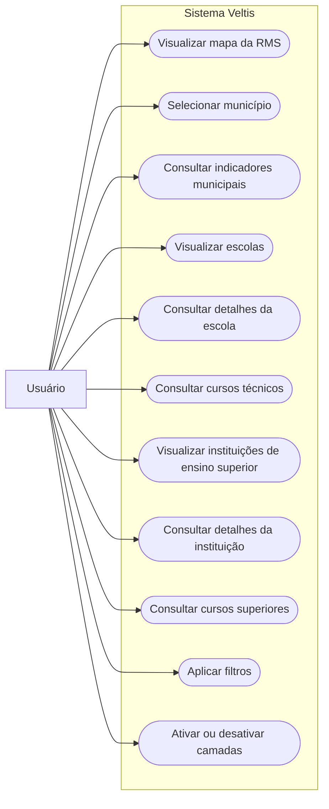

# Casos de uso — Veltis

- **Projeto:** Veltis 
- **Versão:** 1.0
- **Plataforma:** Aplicação web
- **Ator principal:** Usuário

## 1. Diagrama de casos de uso geral

### Figura X – Diagrama de Casos de Uso do Veltis

**Fonte:** Autor.

## 2. Descrição sucinta das funcionalidades

- **Visualizar mapa da RMS:** apresenta a malha geográfica dos municípios da Região Metropolitana de Sorocaba.
- **Selecionar município:** permite escolher um município para consultar as informações relacionadas a ele.
- **Consultar indicadores municipais:** apresenta os indicadores demográficos disponíveis para o município selecionado.
- **Visualizar escolas:** apresenta as escolas cadastradas para o município selecionado, conforme os dados disponíveis.
- **Consultar detalhes da escola:** permite selecionar uma escola e consultar suas informações.
- **Consultar cursos técnicos:** apresenta os cursos técnicos relacionados às escolas, conforme os dados disponíveis.
- **Visualizar instituições de ensino superior:** apresenta as instituições de ensino superior identificadas na área consultada.
- **Consultar detalhes da instituição:** permite selecionar uma instituição de ensino superior e consultar suas informações.
- **Consultar cursos superiores:** apresenta os cursos superiores relacionados à instituição ou ao local de oferta consultado.
- **Aplicar filtros:** permite restringir os resultados por município e pelos filtros disponíveis na interface, como tipo de ensino e rede.
- **Ativar ou desativar camadas:** permite controlar a exibição das camadas disponíveis no mapa.

---

# 3. Especificação dos casos de uso

## UC-01 — Visualizar mapa da RMS

- **Objetivo:** permitir que o usuário visualize a malha geográfica da Região Metropolitana de Sorocaba.
- **Ator(es):** Usuário.
- **Requisito(s) relacionado(s):** RF-02.
- **Interface/plataforma:** Aplicação web.
- **Versão e situação:** 1.0 — documentação inicial.

### Condições
- **Gatilho:** o usuário acessa a aplicação.
- **Pré-condições:** não definidas.
- **Pós-condições:** a malha geográfica disponível é apresentada no mapa.

### Fluxo principal

| Passo | Ator | Ação do ator | Resposta do sistema |
|---|---|---|---|
| 1 | Usuário | Acessa a aplicação. | O sistema carrega a interface e apresenta o mapa. |
| 2 | — | — | O sistema exibe a malha geográfica dos municípios da RMS. |

### Fluxos alternativos e exceções
- Não há fluxos alternativos documentados nesta versão.

### Regras, dados e variações de plataforma
- **Regras relacionadas:** RN-02 e RN-05.
- **Dados relevantes:** malha municipal e identificadores dos municípios.
- **Variações web/mobile:** aplicação web.
- **Critério de aceite:** ao abrir a aplicação, a malha geográfica deve ser apresentada no mapa.

## UC-02 — Selecionar município

- **Objetivo:** permitir que o usuário escolha um município para consultar seus dados.
- **Ator(es):** Usuário.
- **Requisito(s) relacionado(s):** RF-01, RF-03.
- **Interface/plataforma:** Aplicação web.
- **Versão e situação:** 1.0 — documentação inicial.

### Condições
- **Gatilho:** o usuário deseja consultar informações de um município.
- **Pré-condições:** a aplicação deve estar acessível e apresentar os municípios disponíveis.
- **Pós-condições:** o município escolhido passa a ser utilizado como referência para as consultas e exibição dos dados.

### Fluxo principal

| Passo | Ator | Ação do ator | Resposta do sistema |
|---|---|---|---|
| 1 | Usuário | Abre a seleção de municípios. | O sistema apresenta os municípios disponíveis. |
| 2 | Usuário | Escolhe um município. | O sistema aplica a seleção realizada. |
| 3 | — | — | O sistema atualiza os dados e os resultados relacionados ao município selecionado. |

### Fluxos alternativos e exceções
- Não há fluxos alternativos documentados nesta versão.

### Regras, dados e variações de plataforma
- **Regras relacionadas:** RN-01, RN-02 e RN-05.
- **Dados relevantes:** código IBGE e nome do município.
- **Variações web/mobile:** aplicação web.
- **Critério de aceite:** após selecionar um município, os resultados apresentados devem corresponder ao município escolhido.

## UC-03 — Consultar indicadores municipais

- **Objetivo:** permitir que o usuário consulte os indicadores disponíveis para um município.
- **Ator(es):** Usuário.
- **Requisito(s) relacionado(s):** RF-10.
- **Interface/plataforma:** Aplicação web.
- **Versão e situação:** 1.0 — a confirmar conforme a versão entregue.

### Condições
- **Gatilho:** o usuário solicita a consulta de indicadores.
- **Pré-condições:** um município deve estar selecionado.
- **Pós-condições:** os indicadores disponíveis para o município são apresentados.

### Fluxo principal

| Passo | Ator | Ação do ator | Resposta do sistema |
|---|---|---|---|
| 1 | Usuário | Seleciona um município. | O sistema identifica o município selecionado. |
| 2 | Usuário | Solicita a consulta dos indicadores. | O sistema consulta os indicadores disponíveis para o município. |
| 3 | — | — | O sistema apresenta os dados retornados. |

### Fluxos alternativos e exceções
- Não há fluxos alternativos documentados nesta versão.

### Regras, dados e variações de plataforma
- **Regras relacionadas:** não identificadas até o momento.
- **Dados relevantes:** código IBGE, indicador, variável, unidade de medida, período e, quando aplicável, classificações e categorias.
- **Variações web/mobile:** aplicação web.
- **Critério de aceite:** os indicadores apresentados devem corresponder ao município selecionado e aos dados disponíveis na base.

## UC-04 — Visualizar escolas

- **Objetivo:** permitir que o usuário visualize as escolas relacionadas ao município selecionado.
- **Ator(es):** Usuário.
- **Requisito(s) relacionado(s):** RF-03, RF-04, RF-05, RF-07.
- **Interface/plataforma:** Aplicação web.
- **Versão e situação:** 1.0 — documentação inicial.

### Condições
- **Gatilho:** o usuário seleciona a consulta de escolas ou seleciona um município.
- **Pré-condições:** a aplicação deve possuir dados de escolas disponíveis para consulta.
- **Pós-condições:** as escolas correspondentes aos filtros aplicados são apresentadas na interface e, quando houver coordenadas válidas, no mapa.

### Fluxo principal

| Passo | Ator | Ação do ator | Resposta do sistema |
|---|---|---|---|
| 1 | Usuário | Seleciona um município. | O sistema identifica o município selecionado. |
| 2 | Usuário | Acessa a visualização de escolas. | O sistema consulta as escolas relacionadas ao município. |
| 3 | — | — | O sistema apresenta os resultados disponíveis e os pontos que possuem coordenadas válidas. |

### Fluxos alternativos e exceções
- **A partir do passo 3:** quando uma escola não possuir coordenadas disponíveis, ela poderá constar nos resultados da consulta, mas não será exibida como ponto no mapa. A forma de apresentação na interface está a definir.

### Regras, dados e variações de plataforma
- **Regras relacionadas:** RN-01, RN-02, RN-03 e RN-04.
- **Dados relevantes:** código da entidade, nome da escola, município, dependência administrativa e dados de localização disponíveis.
- **Variações web/mobile:** aplicação web.
- **Critério de aceite:** as escolas apresentadas devem corresponder ao município e aos filtros selecionados.

## UC-05 — Consultar detalhes da escola

- **Objetivo:** permitir que o usuário consulte os dados de uma escola selecionada.
- **Ator(es):** Usuário.
- **Requisito(s) relacionado(s):** RF-08.
- **Interface/plataforma:** Aplicação web.
- **Versão e situação:** 1.0 — documentação inicial.

### Condições
- **Gatilho:** o usuário seleciona uma escola nos resultados ou no mapa.
- **Pré-condições:** a escola deve estar disponível nos resultados da consulta.
- **Pós-condições:** os dados disponíveis da escola são apresentados.

### Fluxo principal

| Passo | Ator | Ação do ator | Resposta do sistema |
|---|---|---|---|
| 1 | Usuário | Seleciona uma escola. | O sistema identifica a escola selecionada. |
| 2 | — | — | O sistema consulta os dados associados à escola. |
| 3 | — | — | O sistema apresenta os detalhes disponíveis. |

### Fluxos alternativos e exceções
- Não há fluxos alternativos documentados nesta versão.

### Regras, dados e variações de plataforma
- **Regras relacionadas:** não identificadas até o momento.
- **Dados relevantes:** identificador da escola e informações cadastrais disponíveis.
- **Variações web/mobile:** aplicação web.
- **Critério de aceite:** o painel de detalhes deve apresentar informações correspondentes à escola selecionada.

## UC-06 — Consultar cursos técnicos

- **Objetivo:** permitir que o usuário consulte os cursos técnicos relacionados às escolas.
- **Ator(es):** Usuário.
- **Requisito(s) relacionado(s):** RF-09 (necessita ajuste de identificação conforme a lista definitiva de RF).
- **Interface/plataforma:** Aplicação web.
- **Versão e situação:** 1.0 — a confirmar conforme a versão entregue.

### Condições
- **Gatilho:** o usuário solicita a consulta dos cursos técnicos de uma escola.
- **Pré-condições:** uma escola deve estar selecionada e os dados de cursos técnicos devem estar disponíveis.
- **Pós-condições:** os cursos técnicos associados à escola são apresentados.

### Fluxo principal

| Passo | Ator | Ação do ator | Resposta do sistema |
|---|---|---|---|
| 1 | Usuário | Seleciona uma escola. | O sistema identifica a escola. |
| 2 | Usuário | Solicita a consulta dos cursos técnicos. | O sistema consulta os cursos relacionados à escola. |
| 3 | — | — | O sistema apresenta os cursos disponíveis. |

### Fluxos alternativos e exceções
- Não há fluxos alternativos documentados nesta versão.

### Regras, dados e variações de plataforma
- **Regras relacionadas:** não identificadas até o momento.
- **Dados relevantes:** identificador da escola, código e nome do curso, modalidade e situação, conforme os campos disponíveis.
- **Variações web/mobile:** aplicação web.
- **Critério de aceite:** os cursos apresentados devem estar relacionados à escola selecionada.

## UC-07 — Visualizar instituições de ensino superior

- **Objetivo:** permitir que o usuário consulte as instituições de ensino superior relacionadas à área selecionada.
- **Ator(es):** Usuário.
- **Requisito(s) relacionado(s):** RF-03, RF-04, RF-05, RF-07.
- **Interface/plataforma:** Aplicação web.
- **Versão e situação:** 1.0 — documentação inicial.

### Condições
- **Gatilho:** o usuário seleciona a visualização de instituições de ensino superior.
- **Pré-condições:** os dados de instituições de ensino superior devem estar disponíveis para consulta.
- **Pós-condições:** as instituições correspondentes à consulta são apresentadas.

### Fluxo principal

| Passo | Ator | Ação do ator | Resposta do sistema |
|---|---|---|---|
| 1 | Usuário | Seleciona um município ou aplica os filtros disponíveis. | O sistema identifica os parâmetros da consulta. |
| 2 | Usuário | Acessa a visualização de instituições de ensino superior. | O sistema consulta as instituições relacionadas aos parâmetros selecionados. |
| 3 | — | — | O sistema apresenta os resultados disponíveis e, quando houver coordenadas válidas, os pontos no mapa. |

### Fluxos alternativos e exceções
- **A partir do passo 3:** instituições sem coordenadas disponíveis não podem ser posicionadas no mapa. A apresentação desses registros fora do mapa deve seguir o comportamento definido na interface.

### Regras, dados e variações de plataforma
- **Regras relacionadas:** RN-01, RN-02, RN-03 e RN-04.
- **Dados relevantes:** código da IES, nome, município da sede, tipo, categoria administrativa, organização acadêmica e situação, conforme os dados disponíveis.
- **Variações web/mobile:** aplicação web.
- **Critério de aceite:** os resultados devem corresponder aos filtros selecionados; os pontos devem representar apenas registros com coordenadas válidas.

## UC-08 — Consultar detalhes da instituição

- **Objetivo:** permitir que o usuário consulte os dados de uma instituição de ensino superior.
- **Ator(es):** Usuário.
- **Requisito(s) relacionado(s):** RF-08.
- **Interface/plataforma:** Aplicação web.
- **Versão e situação:** 1.0 — documentação inicial.

### Condições
- **Gatilho:** o usuário seleciona uma instituição nos resultados ou no mapa.
- **Pré-condições:** a instituição deve estar disponível nos resultados da consulta.
- **Pós-condições:** os dados disponíveis da instituição são apresentados.

### Fluxo principal

| Passo | Ator | Ação do ator | Resposta do sistema |
|---|---|---|---|
| 1 | Usuário | Seleciona uma instituição. | O sistema identifica a instituição selecionada. |
| 2 | — | — | O sistema consulta os dados associados à instituição. |
| 3 | — | — | O sistema apresenta os detalhes disponíveis. |

### Fluxos alternativos e exceções
- Não há fluxos alternativos documentados nesta versão.

### Regras, dados e variações de plataforma
- **Regras relacionadas:** não identificadas até o momento.
- **Dados relevantes:** código da IES, nome e informações cadastrais disponíveis.
- **Variações web/mobile:** aplicação web.
- **Critério de aceite:** o painel deve apresentar os dados correspondentes à instituição selecionada.

## UC-09 — Consultar cursos superiores

- **Objetivo:** permitir que o usuário consulte os cursos superiores e seus locais de oferta disponíveis.
- **Ator(es):** Usuário.
- **Requisito(s) relacionado(s):** RF-09.
- **Interface/plataforma:** Aplicação web.
- **Versão e situação:** 1.0 — a confirmar conforme a versão entregue.

### Condições
- **Gatilho:** o usuário solicita a consulta dos cursos superiores de uma instituição.
- **Pré-condições:** a instituição deve estar selecionada e os dados dos cursos devem estar disponíveis.
- **Pós-condições:** os cursos relacionados à instituição ou ao local de oferta consultado são apresentados.

### Fluxo principal

| Passo | Ator | Ação do ator | Resposta do sistema |
|---|---|---|---|
| 1 | Usuário | Seleciona uma instituição ou consulta um município. | O sistema identifica a instituição ou o município de referência. |
| 2 | Usuário | Solicita a consulta dos cursos superiores. | O sistema consulta os cursos e seus locais de oferta disponíveis. |
| 3 | — | — | O sistema apresenta os cursos retornados pela consulta. |

### Fluxos alternativos e exceções
- **A partir do passo 2:** cursos sem município de oferta informado, como pode ocorrer em registros EAD, devem permanecer sem localização municipal, sem inferência de município.

### Regras, dados e variações de plataforma
- **Regras relacionadas:** não identificadas até o momento.
- **Dados relevantes:** código do curso, código da IES, nome, grau acadêmico, modalidade, turno, situação e município/local de oferta quando disponível.
- **Variações web/mobile:** aplicação web.
- **Critério de aceite:** os cursos apresentados devem corresponder à instituição ou ao local de oferta consultado, conforme os dados disponíveis.

## UC-10 — Aplicar filtros

- **Objetivo:** permitir que o usuário refine os resultados exibidos no sistema.
- **Ator(es):** Usuário.
- **Requisito(s) relacionado(s):** RF-03, RF-04, RF-05, RF-06.
- **Interface/plataforma:** Aplicação web.
- **Versão e situação:** 1.0 — documentação inicial.

### Condições
- **Gatilho:** o usuário deseja restringir os resultados apresentados.
- **Pré-condições:** a aplicação deve possuir dados disponíveis para consulta.
- **Pós-condições:** os resultados são atualizados conforme os filtros aplicados.

### Fluxo principal

| Passo | Ator | Ação do ator | Resposta do sistema |
|---|---|---|---|
| 1 | Usuário | Seleciona um ou mais filtros disponíveis. | O sistema registra os filtros selecionados. |
| 2 | Usuário | Aplica a consulta. | O sistema atualiza os resultados conforme os filtros. |
| 3 | — | — | O sistema apresenta os resultados filtrados. |

### Fluxos alternativos e exceções
- Não há fluxos alternativos documentados nesta versão.

### Regras, dados e variações de plataforma
- **Regras relacionadas:** RN-01 e RN-02.
- **Dados relevantes:** município, tipo de ensino, rede e termo de pesquisa, conforme os filtros disponíveis.
- **Variações web/mobile:** aplicação web.
- **Critério de aceite:** os resultados devem respeitar os filtros selecionados.

## UC-11 — Ativar ou desativar camadas

- **Objetivo:** permitir que o usuário controle a exibição das camadas disponíveis no mapa.
- **Ator(es):** Usuário.
- **Requisito(s) relacionado(s):** funcionalidade prevista no diagrama conceitual; requisito formal correspondente a confirmar.
- **Interface/plataforma:** Aplicação web.
- **Versão e situação:** 1.0 — a confirmar conforme a versão entregue.

### Condições
- **Gatilho:** o usuário deseja alterar as informações exibidas no mapa.
- **Pré-condições:** o mapa deve estar carregado e as camadas devem estar disponíveis.
- **Pós-condições:** o mapa apresenta ou oculta a camada selecionada.

### Fluxo principal

| Passo | Ator | Ação do ator | Resposta do sistema |
|---|---|---|---|
| 1 | Usuário | Acessa os controles de camadas. | O sistema apresenta as camadas disponíveis. |
| 2 | Usuário | Ativa ou desativa uma camada. | O sistema atualiza a exibição do mapa conforme a seleção. |

### Fluxos alternativos e exceções
- Não há fluxos alternativos documentados nesta versão.

### Regras, dados e variações de plataforma
- **Regras relacionadas:** não identificadas até o momento.
- **Dados relevantes:** identificação e estado de exibição das camadas disponíveis.
- **Variações web/mobile:** aplicação web.
- **Critério de aceite:** a camada selecionada deve ser exibida ou ocultada no mapa conforme a ação do usuário.

