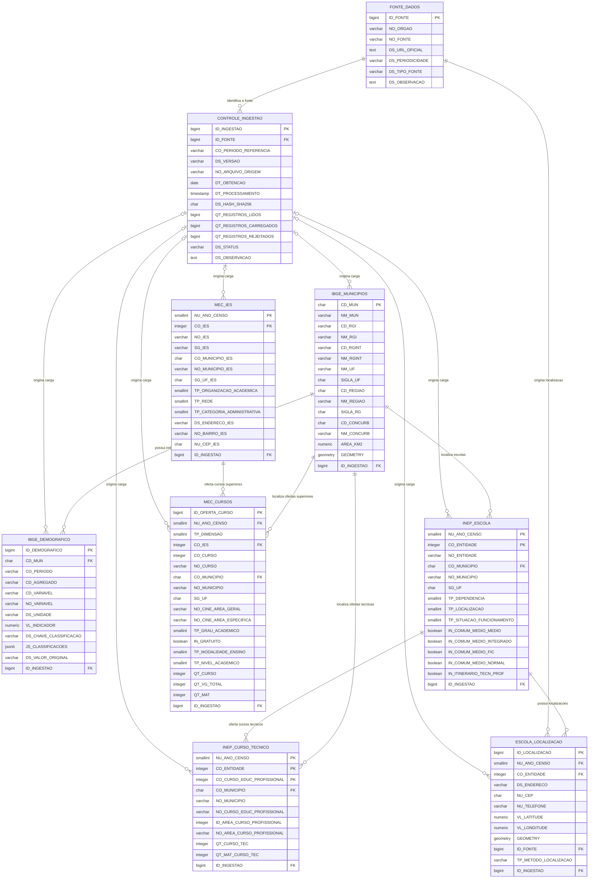

# Diagrama de Entidade-Relacionamento — Veltis

> Modelo lógico baseado nas tabelas e restrições descritas na planilha **Veltis_Dicionario_de_Dados_Completo_2026-10-19.xlsx**.

## Figura X – Diagrama de Entidade-Relacionamento (Lógico)

<b>Fonte:</b> Elaborado pelos autores com base no Dicionário de Dados do Veltis.

## Descrição dos relacionamentos

- **IBGE_MUNICIPIOS — IBGE_DEMOGRAFICO (1:N):** um município pode possuir vários registros de indicadores, referentes a períodos, agregados, variáveis e classificações diferentes. Cada registro demográfico pertence a um município.
- **IBGE_MUNICIPIOS — INEP_ESCOLA (1:N):** um município pode possuir várias escolas. Cada registro de escola está associado a um município pelo código IBGE.
- **IBGE_MUNICIPIOS — INEP_CURSO_TECNICO (1:N):** os registros de cursos técnicos são associados ao município informado na base do Censo Escolar.
- **IBGE_MUNICIPIOS — MEC_CURSOS (1:N):** os cursos superiores são associados ao município do local de oferta quando esse dado está disponível. O município da sede da IES não substitui o município de oferta.
- **INEP_ESCOLA — ESCOLA_LOCALIZACAO (1:N):** uma escola pode possuir registros de localização provenientes de fontes diferentes. A ligação utiliza o ano do Censo e o código da entidade.
- **INEP_ESCOLA — INEP_CURSO_TECNICO (1:N):** uma escola pode ofertar vários cursos técnicos. A relação utiliza o ano do Censo e o código da entidade.
- **MEC_IES — MEC_CURSOS (1:N):** uma instituição de ensino superior pode ofertar vários cursos. A identificação da IES utiliza o ano do Censo e o código da IES.
- **FONTE_DADOS — CONTROLE_INGESTAO (1:N):** uma fonte pode possuir várias execuções de carga registradas.
- **FONTE_DADOS — ESCOLA_LOCALIZACAO (1:N):** cada registro de localização identifica a fonte de onde vieram o endereço e/ou as coordenadas.
- **CONTROLE_INGESTAO — tabelas de dados (1:N):** uma execução de carga pode originar vários registros nas tabelas de dados. O vínculo é feito pelo campo `ID_INGESTAO`, que pode estar nulo conforme a definição da planilha.

## Observações sobre o modelo

1. `IBGE_DEMO_CLASSIF` não aparece no diagrama porque foi removida na migration 002. As classificações e categorias do SIDRA são armazenadas em `IBGE_DEMOGRAFICO`, nos campos `DS_CHAVE_CLASSIFICACAO` e `JS_CLASSIFICACOES`.
2. `MEC_IES` armazena a instituição e o município de sua sede. `MEC_CURSOS` armazena as ofertas e o município do local de oferta. Uma IES sediada fora da Região Metropolitana de Sorocaba pode ofertar cursos em municípios da região.
3. `ESCOLA_LOCALIZACAO` separa os dados de endereço e coordenadas dos dados cadastrais da escola. Assim, uma escola pode continuar cadastrada mesmo quando não possui coordenadas.
4. Os campos `ID_INGESTAO` permitem rastrear a carga de origem dos registros. A planilha informa que esses campos podem ser nulos.
5. O diagrama representa as relações descritas no dicionário. Restrições identificadas na planilha como sugeridas ou lógicas devem ser confirmadas no DDL do PostgreSQL antes de serem tratadas como restrições físicas implementadas.
